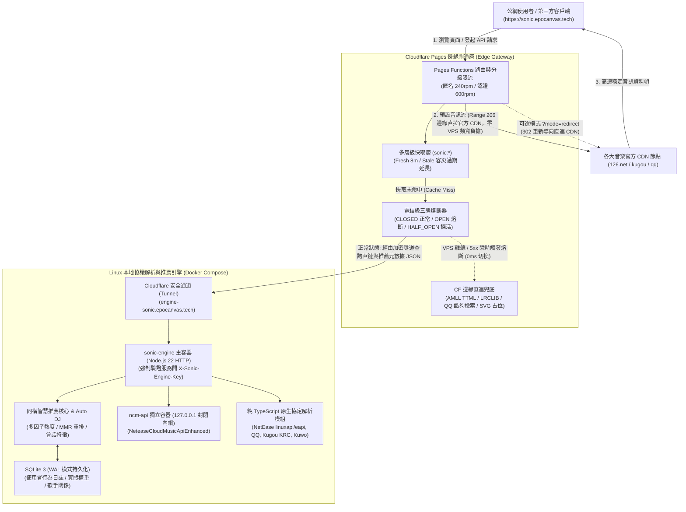
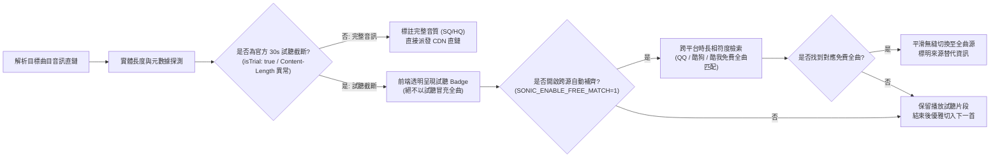

# 🎵 Sonic (epocanvas sonic) — 分散式多源音樂串流平台與智慧邊緣閘道

<div align="center">

[](package.json)
[](package.json)
[](https://pages.cloudflare.com/)
[](docker-compose.yml)
[](player/)
[](tsconfig.json)
[](LICENSE)

**專為高品質音質、毫秒級逐字歌詞、自主智慧推薦與極致隱私而生的新一代現代化音樂平台**

[🌐 線上服務主站 (sonic.epocanvas.tech)](https://sonic.epocanvas.tech) • [備用鏡像 (sonic.epocanvas.com)](https://sonic.epocanvas.com) • [📖 API 介面規格文件](API.md)

</div>

---

## 🌟 專案定位與核心優勢

**Sonic**（總品牌標識：**epocanvas sonic**）是一套獨立自研的現代化全功能音樂串流平台與分散式多源聚合閘道。專案打破傳統單體音樂播放器與中心化後端的束縛，採用 **「Cloudflare 邊緣控制面 + Linux 原生本地協議引擎數據面」** 的同構雙層架構，在提供全網多平台音源聚合與無損/高解析播放的同時，構建了業界領先的輕量級本機智慧音樂推薦引擎與嚴苛的零信任安全體系。

### 🚀 六大核心實際優勢

| 核心維度 | Sonic 實際技術優勢 | 傳統單體 / 開源音樂專案現狀 |
| :--- | :--- | :--- |
| **雙層分離同構架構** | **控制面與數據面分離**：Cloudflare 全球 Anycast 邊緣就近響應、快取與分發；Linux 專屬節點純 TS 運算原生協議；音訊流經由 Range 206 邊緣代理或 302 直取，**完全零消耗 VPS 頻寬**。 | 單體伺服器全量承受流量，高音質串流快速耗盡伺服器頻寬與 CPU，容易因單點障礙導致整站癱瘓。 |
| **同構智慧推薦引擎** | **自主研發輕量化推薦演算法**：多因子熱度模型、指數時間衰減、貝氏平滑、會話搜尋意圖捕捉、真實播放反饋（完播/重播/跳過/拉黑）與 MMR 多樣性重排，並基於本機 SQLite WAL 儲存，**P95 延遲低於 25ms**。 | 無自主推薦能力，僅單純抓取第三方商業平台現成榜單；或依賴龐大繁重的 Python/Spark 大數據叢集，無法輕量化私有部署。 |
| **智慧混合並行搜尋** | **全源同構檢索與容錯**：支援簡繁字形智慧歸一、拼音與縮寫檢索、歌手中英文別名對稱匹配、編輯距離拼寫容錯、版本識別，多源並行獲取並正規化合併。 | 關鍵字錯別字或繁簡轉換即查詢落空，多源搜尋串行等待，介面延遲長且重複歌曲冗餘嚴重。 |
| **毫秒級真逐字動態歌詞** | **全平台原生解析與多語對齊**：原生逆向解析網易雲 YRC、QQ QRC、酷狗 KRC（XOR 解密 + Deflate 解壓），並融合 AMLL TTML 與 LRCLIB；多語系歌詞、羅馬音與翻譯毫秒級精確同步。 | 僅支援普通行級 LRC 滾動歌詞，缺乏字級時間軸；外鏈字級服務單點失效即退化為無歌詞。 |
| **音質真實分級與透明揭露** | **嚴格實體探測與智慧補齊**：提供 FLAC 無損、320kbps 高品質與 128kbps 標準流；**嚴格區分試聽片段與完整曲目**（絕不拿試聽冒充全曲），針對試聽曲目自動觸發跨源平滑補齊。 | 標註 320k 實為 128k 假升頻；或在遭遇 VIP 限制時播放 30 秒片段卻標註為完整播放，體驗割裂。 |
| **零信任架構與隱私主權** | **企業級安全與使用者隱私自主**：Epomail OAuth 2.0 PKCE 認證；HMAC-SHA256 全量簽名防偽 API Key；全鏈路 SSRF 防禦（遮罩雲端 Metadata 與內網 IP）；**一鍵切換純本機/無痕模式，支援一鍵清空個人歷史畫像**。 | 介面無金鑰簽名防護易遭盜刷；存在 SSRF 內網穿透漏洞；強制收集使用者隱私且無透明銷毀機制。 |

---

## 🏛️ 系統架構與數據流向 (Architecture)

Sonic 採用控制面（邊緣）與數據面（本地引擎）深度解耦的混合微服務架構，兼顧低成本、超高彈性與高併發承載能力：



---

## 🧠 自主研發同構智慧推薦與探索系統

Sonic 內建全套自主設計的輕量級同構音樂推薦演算法體系（位於 `functions/_lib/sonic/recommend/` 與 `server/recommend-sqlite.ts`），無需昂貴的外部大數據叢集即可提供精準、平滑、多樣化的專屬推薦：

### 1. 站內多因子熱度模型 (Trending & Popularity)
綜合多維度指標量化熱度得分，拒絕單一播放次數造假刷榜：
$$\text{Score} = w_1 \cdot \text{PlayCount}_{\text{valid}} + w_2 \cdot \text{UV}_{\text{distinct}} + w_3 \cdot \text{CompletionRate} + w_4 \cdot \text{FavoriteRate} + w_5 \cdot \text{Slope}_{\text{growth}}$$
- **權重配置**：有效播放 35% + 獨立聽眾 25% + 完播表現 20% + 收藏轉化 15% + 成長斜率 5%。
- **指數時間衰減**：$S(t) = S_0 \cdot e^{-\lambda \Delta t}$，分設 24 小時即時飆升榜（$\lambda$ 較大）與 7 天累計熱榜。
- **貝氏與 Wilson Score 平滑**：對新發布及長尾歌曲引入平滑先驗，避免極少播放但 100% 完播的偶發事件異常置頂。

### 2. 即時搜尋意圖理解 (Search Intent Understanding)
- **會話級意圖追蹤**：記錄使用者在單次會話中連續搜尋的關鍵字、點擊曲目的歌手、流派與語種特徵。
- **動態意圖向量**：為即時意圖賦予較高的短期衰減權重，並與長期偏好檔案分層解耦，搜尋後的高價值行為（完播/收藏）才會沉澱至長期偏好。

### 3. 多階行為反饋模型與 Auto DJ 智慧連播
系統在 `engine.ts` 中精確量化每項使用者互動訊號：
* `favorite`（加入最愛）：極強正向訊號，權重 **+4.0**
* `replay`（曲目重播）：強烈喜愛訊號，權重 **+3.5**
* `play_complete`（有效完播）：標準正向訊號，權重 **+2.5**
* `play_progress`（進度聆聽）：按收聽比例分階動態給分，權重 **+0.2 ~ +1.8**
* `skip`（快速跳過）：負向訊號，權重 **-0.8**（但聽過半後的切歌視為自然播放結束，計算微正向權重 **+0.25**）
* `dislike`（明確不喜歡）：明確排斥，硬過濾並列入專屬黑名單，權重 **-5.0**
* **雜訊與假訊號淨化**：因網路卡頓、解碼失敗或 30 秒官方試聽截斷導致的切歌，權重**恆定歸零且不入庫**，確保推薦數據池純淨。
* **Auto DJ 智慧電台**：結合當前播放上下文與種子曲目風格，動態演算過渡自然的後續播放序列。

### 4. 內容相似性與 MMR 多樣性重排 (Content-Based & Diversity)
- **特徵相似度計算**：融合歌手關係圖譜、語言、風格標籤的 Jaccard 集合相似度與音訊特徵的 Cosine 餘弦相似度。
- **MMR (Maximal Marginal Relevance) 邊際相關性重排**：平衡推薦曲目的「精準度」與「新穎多樣性」，避免傳統演算法陷入單一歌手或曲風的資訊繭房。

---

## 🔍 音質分級探測與來源透明機制

Sonic 秉持**真實誠信、合規溯源與零虛標**原則：

### 1. 來源技術組成
* **本地原生自主解析 (`local-engine`) [> 90%]**：VPS 本地 Node.js 22 純 TypeScript 加密協議 + 內網 `ncm-api` 容器，直接取得官方 CDN 簽發的完整 320kbps MP3 / FLAC 直鏈，支援標準 HTTP `Range: bytes=0-` 分段加載與 `206 Partial Content` 響應。
* **全球開源歌詞庫 (`amll` / `lrclib`) [~ 10%]**：在本地原生歌詞缺失或節點降級時，無縫銜接 AMLL 逐字時間軸與 LRCLIB 權威校準庫。
* **第三方免費聚合上游 (`gdstudio` / `lyriva`) [0%]**：預設**嚴格關閉**（`SONIC_ENABLE_GDSTUDIO=0`、`SONIC_ENABLE_LYRIVA=0`），僅保留作為極端環境下的手動應急備用。
* **版權與合規邊界**：本專案不整合任何繞過付費版權的非法解灰二進位套件，合法會員曲目支援由伺服器端環境變數掛載個人授權 Cookie，公開曲目則遵循官方開放協議。

### 2. 嚴格試聽偵測與跨源自動補齊


---

## ⚡ API 閘道統一介面規格 (Gateway Specification)

Sonic 提供規範的 RESTful API 規格，對外統一承諾 `brand: "Sonic"` 相容性契約。

### 1. 核心端點導航清單

| 分類 | 方法 | 路由端點 | 功能說明與調度邏輯 |
| :--- | :---: | :--- | :--- |
| **智慧推薦** | `GET` | `/api/sonic/recommend/for-you` | **猜你喜歡 / Auto DJ**：融合完播率、收藏、即時搜尋與 MMR 多樣性重排 |
| | `GET` | `/api/sonic/recommend/trending` | **真實趨勢熱榜**：支援 `24h`/`7d`/`surging`/`new` 週期，內建對數防刷與時間衰減 |
| | `GET` | `/api/sonic/recommend/similar` | **相似曲目/歌手探索**：基於歌手圖譜與歌曲特徵餘弦計算 |
| | `GET` | `/api/sonic/recommend/discover` | **風格流派雷達**：支援指定流派過濾與 `temperature` 探索廣度調節 |
| | `POST` | `/api/sonic/events` | **回傳使用者行為事件**：採集播放、完播、跳過、收藏，自動過濾卡頓雜訊 |
| | `DELETE`| `/api/sonic/events` | **一鍵清空個人畫像**：立即銷毀使用者在推薦引擎中的所有特徵與紀錄 |
| **聚合搜尋** | `GET` | `/api/sonic/search/smart` | **智慧混合搜尋與補全**：簡繁歸一、拼音縮寫、別名對稱、拼寫容錯與相關性排序 |
| | `GET` | `/api/sonic/search/nexus` | **全網多源並行檢索**：並行查詢網易、QQ、酷狗、酷我並正規化去重 |
| **動態歌詞** | `GET` | `/api/sonic/lyrics/nexus` | **全網逐字歌詞入口**：①原生逐字 (YRC/QRC/KRC) → ②AMLL TTML → ③LRCLIB |
| | `GET` | `/api/sonic/lyrics/sync` | **跨平台同步歌詞**：支援 `format=sonic\|lrc\|ttml\|json` 等多種格式輸出 |
| **音訊媒體** | `GET` | `/api/music/stream` | **音訊分段代理**：支援 HTTP `Range` 與 `206 Partial Content`，支援 `?mode=redirect` 直連 |
| | `GET` | `/api/music/cover` | **高畫質封面代理**：優先解析高畫質原圖，失敗平滑降級至品牌向量 SVG |
| | `GET` | `/api/music/palette` | **封面色調分析**：自適應運算播放器背景毛玻璃主色調與最佳對比度漸變 |
| **系統健康** | `GET` | `/api/sonic/engine/health` | **本地引擎診斷**：服務間專用探活與熔斷器狀態檢查（需內部金鑰驗證） |

### 2. 標準回傳結構範例
```json
{
  "brand": "Sonic",
  "data": {
    "id": "191254",
    "title": "紅豆",
    "artist": "王菲",
    "album": "唱遊",
    "quality": "320k",
    "duration": 259,
    "isTrial": false
  },
  "meta": {
    "cached": true,
    "cacheLevel": "edge",
    "latencyMs": 18,
    "provider": "nexus",
    "degraded": false,
    "circuitState": "CLOSED",
    "attempts": [
      { "provider": "local-engine", "via": "local-engine", "source": "local-netease", "ok": true, "ms": 14 }
    ]
  }
}
```

---

## 🛡️ 電信級三態容災與降級狀態機 (Fault Tolerance)

為保障在任何極端網路波動或伺服器維護時使用者依然可流暢聽歌，Sonic 邊緣層內建**電信級三態熔斷器**：

```
       [ CLOSED 正常態 ]
          │          ▲
 連續 3 次失敗或超時    │ 探活成功 (Health Probe OK)
 (Latency > 4.5s)    │
          ▼          │
       [ OPEN 熔斷態 ] ── 冷卻時間結束 (30s) ──> [ HALF_OPEN 探活態 ]
```

1. **瞬時自適應熔斷**：當 Linux VPS 發生硬體重啟、網路波動、Cloudflare Tunnel `530` / `502` 或連續 3 次調用超時（預算 4.5 秒）時，狀態機立即轉入 `OPEN` 熔斷狀態。
2. **0ms 立即切入邊緣降級層**：
   - 後續公網請求**不再白等超時**，耗時 0ms 立即啟用 Cloudflare Pages 邊緣直連模式；
   - 搜尋與歌詞由 CF 邊緣節點直接連線 QQ / 酷狗公開介面及 AMLL / LRCLIB 全球庫，前端響應標頭標明 `X-Sonic-Degraded: 1`；
   - Web 播放器頂部自動亮起優雅的琥珀色膠囊提示：**「邊緣降級模式 · 本地解析後端暫時離線」**，前端停止連環跳歌風暴，保障已有曲目穩定播放；
3. **無感平滑復原**：冷卻時間（預設 30 秒）過後，熔斷器進入 `HALF_OPEN` 狀態並發起背景單次探針，確認 VPS 服務復原後自動閉合（`CLOSED`），前端膠囊自動平滑消失。

---

## 🔒 零信任安全規範與 API Key 認證

為防止公網介面遭到惡意爬蟲濫用或偽造，Sonic 採用嚴謹的認證與金鑰簽發規範：

1. **HMAC-SHA256 版本化簽名防偽**：
   所有專案 API Key 均採用下列版本化格式：
   $$\text{API\_Key} = \text{sonic\_live\_v2}.\langle \text{Header} \rangle.\langle \text{Payload} \rangle.\langle \text{Signature} \rangle$$
   - Header 宣告 `{ alg: "HS256", typ: "sonic-api-key", v: 2, kid }`；Payload 包含 `{ sub, iat, exp, jti, kid, role, uid }`；
   - 簽名由伺服器端強隨機金鑰（`SONIC_SECRET`，長度 $\ge 32$ 字元）對 `sonic_live_v2.<header>.<payload>` 實施 HMAC-SHA256；
   - 伺服器端使用 Web Crypto `crypto.subtle.verify` 進行常數時間比對，並嚴格檢查版本、`kid`、`iat`/`exp`、`jti` 與撤銷清單；
   - 舊版 **v1 及無簽名金鑰一律拒絕**（Fail-closed）。本次升級後既有使用者需重新登入 OAuth 取得 v2 Key；
   - 金鑰輪換：將舊密鑰移入 `SONIC_SECRET_PREV`；撤銷：`SONIC_REVOKED_JTIS`、`SONIC_REVOKED_SUBS` 或全域下限 `SONIC_TOKEN_MIN_IAT`。
2. **傳遞方式標準化**：
   僅允許在 HTTP 請求標頭中傳遞金鑰；URL Query `?api_key=` 已完全移除，避免金鑰洩漏至伺服器存取日誌、瀏覽器歷史或 HTTP Referer：
   ```http
   X-Sonic-Key: sonic_live_v2.<header>.<payload>.<signature>
   # 或相容標準 Authorization 標頭：
   Authorization: Bearer sonic_live_v2.<header>.<payload>.<signature>
   ```
3. **瀏覽器 OAuth 會話隔離**：
   - 登入使用 `state` + PKCE S256；`state`/`code_verifier` 存放於短效 `HttpOnly` Cookie，回調時強制校驗，缺失或重放一律拒絕；
   - 回調成功後僅簽發 `HttpOnly; Secure; SameSite=Lax` 的 `sonic_session` Cookie，API Key **不寫入 URL hash、查詢參數或 localStorage**；
   - `GET /api/auth/user` 僅返回資料；需取得 Key 時呼叫 `GET /api/auth/key`；`POST /api/auth/key` 重新簽發必須顯式提供當前 Key 請求頭；
   - 撤銷：`POST /api/auth/revoke` 需顯式 Key 請求頭；配置 `SONIC_KEY_REVOCATION_KV` + `SONIC_ENABLE_KEY_REVOCATION=1` 時即時撤銷 jti，否則返回 501 並提示改用 `SONIC_REVOKED_JTIS`；
   - 登出使用 `POST /api/auth/logout`；配置 KV 撤銷存儲時會同時撤銷當前 jti。
4. **SSRF 全鏈路立體攔截**：
   針對媒體代理與音源外鏈轉發，Sonic 實施標準化 IP 規範解析，強行阻斷 `127.0.0.1`、RFC 1918 私有區域網路、Docker 內部網橋以及雲端伺服器中繼資料地址（如 `169.254.169.254`），並在每次重定向時重新校驗目標與 DNS 解析結果。

---

## 🛠️ 快速開始與部署指南 (Deployment Guide)

### 方案 A：Cloudflare Pages 邊緣網關部署（推薦）

```bash
# 1. 複製專案庫並安裝相依套件（需要 Node.js >= 22.13）
git clone git@github.com:shijianus/sonic.git
cd sonic
corepack enable
corepack prepare pnpm@10.34.5 --activate
npm ci
pnpm --dir player install --frozen-lockfile

# 2. 構建前端 SPA 與雙端產物
npm run build

# 3. 部署至 Cloudflare Pages (專案名稱: cfsolara)
npx wrangler pages deploy dist --project-name cfsolara

# 4. 在 Cloudflare Pages 後台設定加密環境變數
# SONIC_SECRET: 由 openssl rand -base64 48 生成
# SONIC_ENGINE_SECRET: 由 openssl rand -base64 48 生成 (需與 VPS 保持一致)
# SONIC_LOCAL_ENGINE_URL: 設定為 https://engine-sonic.epocanvas.tech
```

### 方案 B：Linux VPS 本地協議解析引擎部署 (Docker Compose)

```bash
# 1. 在伺服器上建立目標工作目錄
mkdir -p /opt/sonic && cd /opt/sonic

# 2. 取得原始碼（Dockerfile 會自行構建前端與 Node 引擎，不依賴本機 dist/）
git clone git@github.com:shijianus/sonic.git .
# 或將已檢出的倉庫放在此目錄

# 3. 準備 .env 配置檔並賦予嚴格權限 (600)
cp .env.example .env
chmod 600 .env
vim .env  # 填入強隨機 SONIC_ENGINE_SECRET 與 SONIC_SECRET

# 4. 從乾淨原始碼構建並啟動容器堆疊 (包含 sonic-engine 與 ncm-api)
docker compose up -d --build

# 5. 驗證容器運作狀態與健康檢查
docker compose ps
curl -H "X-Sonic-Engine-Key: <YOUR_SECRET>" http://127.0.0.1:8080/api/sonic/engine/health
```

> 部署、備份/還原、健康檢查、OAuth 配置、限流與回滾細節見 [docs/OPERATIONS.md](docs/OPERATIONS.md)。

### ⚙️ 核心環境變數配置參考 (`.env.example`)

```ini
# ==============================================================================
# Sonic Music Gateway — 環境變數設定範本 (.env.example)
# ==============================================================================

# 1. 服務間通訊與本機引擎安全 (Pages 與 VPS 雙側必配，長度 >= 32 字元)
SONIC_LOCAL_ENGINE_URL="https://engine-sonic.epocanvas.tech"
SONIC_ENGINE_SECRET="<請使用 openssl rand -base64 48 生成強隨機金鑰>"
# Linux 引擎對所有 /api 路由強制驗證此金鑰（不依賴 Host / X-Forwarded-Host）

# 2. API Key 全量簽名金鑰 (必配，長度 >= 32 字元)
SONIC_SECRET="<請使用 openssl rand -base64 48 生成強隨機金鑰>"
# 輪換過渡期金鑰 (選配)，舊 Key 於過渡期後應移除：
# SONIC_SECRET_PREV=""
# 選配穩定 kid 標籤；未設定時由密鑰派生：
# SONIC_SECRET_KID="prod-2026-01"
# SONIC_SECRET_PREV_KID="prod-2025-12"
# 撤銷策略 (逗號分隔，需重新部署生效)：
# SONIC_REVOKED_JTIS=""
# SONIC_REVOKED_SUBS=""
# SONIC_TOKEN_MIN_IAT="0"
# API Key 僅接受請求標頭；?api_key= 已完全移除
# 可選即時撤銷：在 Pages 綁定 SONIC_KEY_REVOCATION_KV，並設定 SONIC_ENABLE_KEY_REVOCATION=1

# 3. Epomail OAuth 2.0 鑑權登入 (選配)
EPOMAIL_BASE_URL="https://mail.epocanvas.com"
EPOMAIL_CLIENT_ID=""
EPOMAIL_CLIENT_SECRET=""
SONIC_ALLOWED_ORIGINS="https://sonic.epocanvas.tech,https://sonic.epocanvas.com"

# 4. 本地原生音源協定啟用開關 (1 啟用, 0 停用)
SONIC_ENABLE_NETEASE="1"
SONIC_ENABLE_QQ="1"
SONIC_ENABLE_KUGOU="1"
SONIC_ENABLE_KUWO="1"
SONIC_ENABLE_AMLL="1"
SONIC_ENABLE_LRCLIB="1"
SONIC_ENABLE_FREE_MATCH="1"

# 5. 第三方免費聚合上游與 VIP 解灰 (預設嚴格關閉，保障合規與高可用)
SONIC_ENABLE_GDSTUDIO="0"
SONIC_ENABLE_LYRIVA="0"
SONIC_ENABLE_UNBLOCK="0"

# 6. 超時與熔斷參數配置 (毫秒)
SONIC_TIMEOUT_MS="8000"
SONIC_ENGINE_TIMEOUT_MS="4500"
SONIC_CB_FAILURE_THRESHOLD="3"
SONIC_CB_COOLDOWN_MS="30000"
SONIC_RATE_LIMIT_ANON_RPM="240"
SONIC_RATE_LIMIT_AUTH_RPM="600"
```

---

## 📚 安全、合規與運維文檔

- [整改記錄與實測結果](docs/AUDIT_REMEDIATION.md)
- [生產運維手冊（部署、備份/恢復、回滾、密鑰輪換、監控）](docs/OPERATIONS.md)
- [許可證、依賴與音樂內容合規核驗](docs/COMPLIANCE.md)
- [第三方依賴聲明](THIRD_PARTY_NOTICES.md)
- [已知問題與技術局限](docs/KNOWN_ISSUES.md)

---

## 💖 致謝與開源協議參考 (Credits)

Sonic 平台的研發與多源聚合實踐借鑑並致謝以下優秀的開源社群專案與研究成果：

- **Meting**：https://github.com/metowolf/Meting
- **Meting-API-Serverless**：https://github.com/Warma10032/Meting-API-Serverless
- **ourcraft-music-api**：https://github.com/Yuncan050115/ourcraft-music-api
- **music-lib**：https://github.com/guohuiyuan/music-lib
- **NeteaseCloudMusicApi**：https://github.com/Binaryify/NeteaseCloudMusicApi
- **QQMusicApi**：https://github.com/jsososo/QQMusicApi
- **AMLL (Timed Text XML API)**：https://github.com/amll-dev/amll-ttml-api
- **LRCLIB (Synced Lyrics)**：https://lrclib.net/docs
- **GDStudio Music API**：https://music-api.gdstudio.xyz/api.php
- **Linux.do 社群**：感謝 @ufoo 大佬提供靈感與技術交流

---

## 📄 版權與許可證 (Copyright & License)

Copyright © 2026 **epocanvas & CFSolara Contributors**. The root `LICENSE` file is the authoritative license text.

> [!IMPORTANT]
> **許可證聲明不一致（待維護者裁決）**：本倉庫根目錄的 [`LICENSE`](LICENSE) 文件目前為 **MIT License**；而本 README 歷史版本與 `player/package.json` 曾聲明 **CC BY-NC-SA 4.0**。兩者不能同時成立。在維護者明確裁決並統一之前，請以倉庫根目錄的 `LICENSE` 文件為準；本次整改不會擅自變更專案許可證。詳細核驗記錄與待辦見 [docs/COMPLIANCE.md](docs/COMPLIANCE.md)。

無論最終採用何種開源許可證，以下限制均適用：
- **第三方內容**：音樂錄音、歌詞、封面、藝人圖片等內容的權利歸屬於各自權利人；本專案不授予任何音樂內容的再授權；
- **非商業與合規**：部署者需自行確認其使用場景符合當地法律、上游服務條款與內容授權要求；
- **商標與品牌**：epocanvas / Sonic 名稱與標識不隨源碼許可證授予商標使用權。
