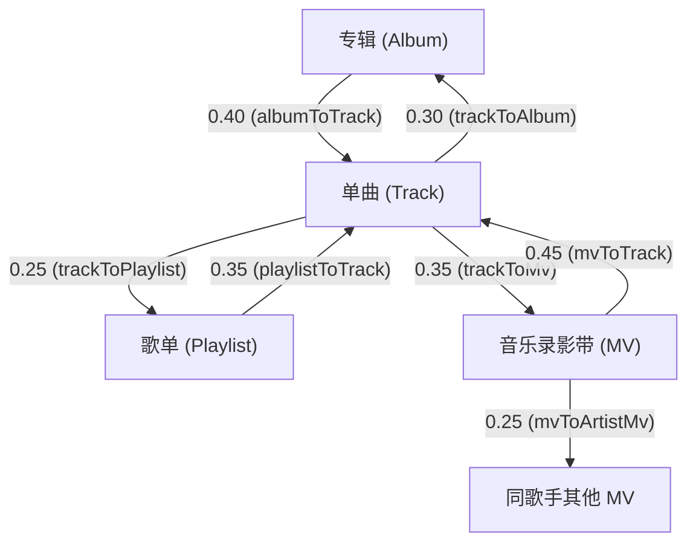

# Sonic 多实体（歌集 / MV / 单曲）混合推荐与信号传播设计

> **架构定位**：Sonic 智能推荐系统多实体增强模块（Multi-Entity Hybrid Recommendation Engine）  
> **设计哲学**：轻量本地部署、SQLite WAL 本地持久化、零隐私泄露、P95 延迟 < 25ms、100% 向后兼容。

---

## 一、背景与设计理念

传统流媒体音乐推荐大多仅聚焦于「单曲（Track）」维度，导致两类严重脱节：
1. **实体推荐缺失**：用户在雷达和「猜你喜欢」中难以发现整张概念专辑（Album）、精心制作的主题歌单（Playlist）以及官方音乐录影带（MV）。
2. **信号闭环断裂**：用户对整张专辑的收藏或对 MV 的完整观看，无法反哺给内部曲目的推荐；同样，用户对单曲的长期单曲循环也未能有效触发其专辑与 MV 影像的曝光。

Sonic 借鉴了工业界开源推荐架构思想（Gorse 的统一 Item 多路召回融合、Playlist 向量特征加权投影、Embeat 实体图谱与共现通道），在 Node.js 22 + SQLite WAL 轻量架构下完成了多实体推荐的「产品化落地」，实现**单曲、专辑、歌单、MV 的统一建模、多路召回与双向软传播**。

---

## 二、统一实体模型与 SQLite 存储方案

### 1. SQLite 核心表结构（迁移 SQL）

```sql
-- 1. 统一实体元数据表 (entities)
CREATE TABLE IF NOT EXISTS entities (
  entity_id TEXT PRIMARY KEY,               -- 'trk_<hash>' | 'alb_<hash>' | 'pl_<hash>' | 'mv_<hash>'
  entity_type TEXT NOT NULL,                -- 'track' | 'album' | 'playlist' | 'mv'
  title TEXT NOT NULL,
  subtitle TEXT,
  artist_id TEXT,
  artist_name TEXT,
  cover_url TEXT,
  source TEXT NOT NULL DEFAULT 'sonic',
  source_id TEXT,
  tags_json TEXT,                           -- JSON array of strings
  language TEXT,
  duration INTEGER DEFAULT 0,
  external_popularity REAL DEFAULT 0,       -- [0, 100]
  created_at INTEGER NOT NULL,
  updated_at INTEGER NOT NULL,
  payload_json TEXT NOT NULL                -- 完整预览字段 (曲目预览、画质、发行日期等)
);

CREATE INDEX IF NOT EXISTS idx_entities_type_updated
  ON entities(entity_type, updated_at DESC);
CREATE INDEX IF NOT EXISTS idx_entities_artist
  ON entities(artist_name);

-- 2. 实体关系图谱表 (entity_relations)
CREATE TABLE IF NOT EXISTS entity_relations (
  relation_id TEXT PRIMARY KEY,             -- 'parent_id:::child_id:::relation_type'
  parent_id TEXT NOT NULL,
  parent_type TEXT NOT NULL,
  child_id TEXT NOT NULL,
  child_type TEXT NOT NULL,
  relation_type TEXT NOT NULL,              -- 'contains' (歌集含单曲) | 'video_of' (MV关联单曲)
  weight REAL NOT NULL DEFAULT 1.0,
  position INTEGER DEFAULT 0,
  created_at INTEGER NOT NULL
);

CREATE INDEX IF NOT EXISTS idx_rel_parent
  ON entity_relations(parent_id, child_id);
CREATE INDEX IF NOT EXISTS idx_rel_child
  ON entity_relations(child_id, parent_id);

-- 3. 实体级用户行为反馈表 (user_entity_feedback)
CREATE TABLE IF NOT EXISTS user_entity_feedback (
  feedback_id TEXT PRIMARY KEY,
  subject_key TEXT NOT NULL,                -- 'usr:<hash>' | 'anon:<id>'
  entity_type TEXT NOT NULL,
  entity_id TEXT NOT NULL,
  action TEXT NOT NULL,                     -- 'favorite' | 'play_complete' | 'watch_complete' | ...
  weight REAL NOT NULL,
  progress REAL,
  context_json TEXT,
  created_at INTEGER NOT NULL
);

CREATE INDEX IF NOT EXISTS idx_uef_user_time
  ON user_entity_feedback(subject_key, created_at DESC);
CREATE INDEX IF NOT EXISTS idx_uef_entity_time
  ON user_entity_feedback(entity_id, created_at DESC);
CREATE INDEX IF NOT EXISTS idx_uef_user_entity
  ON user_entity_feedback(subject_key, entity_id);

-- 4. 实体热度统计表 (entity_stats)
CREATE TABLE IF NOT EXISTS entity_stats (
  entity_id TEXT PRIMARY KEY,
  entity_type TEXT NOT NULL,
  play_count INTEGER DEFAULT 0,
  complete_count INTEGER DEFAULT 0,
  favorite_count INTEGER DEFAULT 0,
  open_count INTEGER DEFAULT 0,
  unique_users INTEGER DEFAULT 0,
  score REAL DEFAULT 0,
  updated_at INTEGER NOT NULL
);
```

### 2. 实体聚合与冷启动资产自动构建

若上游暂无独立专辑库或 MV 接口，Sonic 内置曲库自动聚合引擎 (`ensureMultiEntityCatalogSeeded`)：
- **官方专辑（Album）**：由 `canonical_tracks` 按 `(cleanAlbum, canonicalArtist)` 聚合生成，自动关联内部全部收录曲目。
- **主题歌单（Playlist）**：基于流派标签（如华语 R&B、港乐黄金年代、深夜抒情）聚合曲目形成系统推荐歌单。
- **官方 MV（MV）**：为热门曲目生成官方高清视觉影像占位实体，建立 `mv -(video_of)-> track` 拓扑。

---

## 三、事件采集协议与权重体系

### 1. 事件上报协议 (`POST /api/sonic/events`)

请求体支持单对象或数组：
```json
{
  "events": [
    {
      "entity_type": "album",
      "entity_id": "alb_yehuimei",
      "action": "favorite",
      "session_id": "sess_8f3d",
      "context": { "from": "album_detail" }
    },
    {
      "entity_type": "mv",
      "entity_id": "mv_qingtian",
      "action": "watch_complete",
      "progress": 1.0,
      "context": { "from": "radar" }
    }
  ]
}
```

### 2. 行为可信度权重配置表

| 行为类别 | 行为枚举 (`action` / `type`) | 得分权重 (`weight`) | 说明与防作弊策略 |
| :--- | :--- | :--- | :--- |
| **强正向意图** | `favorite` | `+4.0` | 显式收藏，用户最高意向表达 |
| **强收听粘性** | `replay` | `+3.5` | 单曲循环 / 反复收听 |
| **完播 / 完看** | `play_complete` / `watch_complete` | `+2.5` | 听完单曲或完整看完 MV |
| **归纳整理** | `add_to_playlist` | `+2.0` | 加入自建歌单 |
| **深度消费** | `play_progress` / `watch_progress` (>=75%) | `+1.8` | 进度超过 75% |
| **中度消费** | `play_progress` / `watch_progress` (>=45%) | `+1.2` | 进度过半或播放超过 60 秒 |
| **浅度起播** | `play_start` | `+0.35` | 开始播放 |
| **详情了解** | `open` | `+0.5` | 打开专辑或 MV 详情页（弱正向探索意图） |
| **正常过半跳过** | `skip` (进度 >= 50%) | `+0.25` | 听过半后切歌，计为微正向，不惩罚 |
| **早期手动跳过** | `skip` (进度 < 20%) | `-0.8` | 早期手动切歌，弱负向反馈 |
| **网络 / 试听保护**| `skip` (`reason` 为网络卡顿/试听结束) | `0.0` | **噪声过滤：绝不误判为用户负向反馈！** |
| **显式屏蔽** | `dislike` | `-5.0` | 硬过滤本实体 + 弱惩罚关联实体 |

---

## 四、双向软信号传播算法 (Bidirectional Soft Propagation)

### 1. 传播拓扑规则



### 2. 默认传播系数与环境变量覆盖

| 传播路径 | 环境变量 | 默认系数 | 算法说明 |
| :--- | :--- | :--- | :--- |
| `Album -> Track` | `SONIC_PROPAGATE_ALBUM_TO_TRACK` | `0.40` | 喜欢整张专辑，分摊给内部所有曲目 |
| `Playlist -> Track`| `SONIC_PROPAGATE_PLAYLIST_TO_TRACK` | `0.35` | 收藏歌单，分摊给收录曲目 |
| `Track -> Album` | `SONIC_PROPAGATE_TRACK_TO_ALBUM` | `0.30` | 经常完播单曲，提升其专辑推荐优先级 |
| `Track -> Playlist`| `SONIC_PROPAGATE_TRACK_TO_PLAYLIST`| `0.25` | 喜爱单曲，关联提升收录该曲的主题歌单 |
| `Track -> MV` | `SONIC_PROPAGATE_TRACK_TO_MV` | `0.35` | 喜欢单曲，主动向用户推荐高清 MV 影像 |
| `MV -> Track` | `SONIC_PROPAGATE_MV_TO_TRACK` | `0.45` | 完整观看 MV，强力拉动对应单曲的听歌雷达 |
| `MV -> 同歌手 MV` | `SONIC_PROPAGATE_MV_TO_ARTIST_MV` | `0.25` | 观看 MV，推荐该歌手其他视觉代表作 |
| `Dislike 传播` | `SONIC_PROPAGATE_DISLIKE` | `0.15` | **dislike 仅对本实体硬屏蔽，对关联实体仅做 0.15 软惩罚，绝不连坐误杀** |

---

## 五、混合 Feed 推荐输出与 MMR 重排

### 1. 混合 Feed 响应契约 (`GET /api/sonic/recommend/for-you?feed=mixed`)

```json
{
  "brand": "Sonic",
  "data": [
    {
      "type": "track",
      "id": "trk_186016",
      "title": "晴天",
      "subtitle": "周杰伦 · 叶惠美",
      "cover": "https://p1.music.126.net/...",
      "score": 0.942,
      "reason": "常听 周杰伦 · 偏好风格匹配",
      "payload": {
        "artist": "周杰伦",
        "album": "叶惠美",
        "duration": 269,
        "platform": "netease",
        "streamType": "full"
      }
    },
    {
      "type": "album",
      "id": "alb_yehuimei",
      "title": "叶惠美",
      "subtitle": "周杰伦 · 专辑 · 11 首曲目",
      "cover": "https://p1.music.126.net/...",
      "score": 0.915,
      "reason": "因为你深度收听了该专辑内的曲目《晴天》",
      "payload": {
        "artist": "周杰伦",
        "trackCount": 11,
        "tracksPreview": ["晴天", "梯田", "东风破", "以父之名"],
        "releaseDate": "2003-07-31"
      }
    },
    {
      "type": "mv",
      "id": "mv_qingtian",
      "title": "晴天 (Official MV)",
      "subtitle": "周杰伦 · 官方音乐录影带",
      "cover": "https://p1.music.126.net/...",
      "score": 0.887,
      "reason": "你常听这首单曲，推荐观看官方视觉影像",
      "payload": {
        "artist": "周杰伦",
        "duration": 269,
        "hasVideo": true,
        "resolution": "1080p",
        "relatedTrackId": "trk_186016"
      }
    }
  ],
  "meta": {
    "latency_ms": 14,
    "strategy": "hybrid-multi-entity",
    "distribution": { "track": 11, "album": 4, "playlist": 1, "mv": 2 },
    "personalized": true,
    "total": 18
  }
}
```

### 2. 配额比例与连续实体惩罚 MMR (Maximal Marginal Relevance)

- **默认配额区间**：
  - 单曲（Track）：`55% ~ 70%`（基准 60%）
  - 歌集（Album / Playlist）：`15% ~ 25%`（基准 25%）
  - 影像（MV）：`10% ~ 20%`（基准 15%）
- **类型连续惩罚（Consecutive Penalty）**：
  若当前候选项与上一个已选实体的 `entity_type` 相同，施加 `0.28` 冗余惩罚，使得卡片呈现「单曲 - 单曲 - 专辑 - 单曲 - MV - 歌单」的自然交织排布。
- **歌手垄断上限（Max Per Artist）**：
  单一歌手在整个 18 项列表中最多出现 3 次。
- **平滑降级（Graceful Degradation）**：
  若某实体类型候选池为空（例如早期冷启动无 MV），引擎自动将配额平滑释放给单曲与专辑，保证输出列表完整。

### 3. 如何关闭某类型推荐

客户端可通过 `types` 参数精确控制：
- 仅需要单曲：`?types=track`
- 仅需要单曲与专辑：`?types=track,album`
- 排除 MV：`?types=track,album,playlist`

---

## 六、向后兼容性与隐私隔离保证

1. **旧客户端只读单曲完全兼容**：
   - 不带 `feed=mixed` 参数的调用（如现有播放器 UI 调用的 `/api/sonic/recommend/for-you?count=18`），默认保持返回现有数据结构 `{ mode, personalized, tracks: [...] }`，绝不破坏现有生产前端。
2. **隐私一键清空 (`DELETE /api/sonic/events`)**：
   - 同时物理删除 SQLite 中的 `behavior_events`（单曲行为）与 `user_entity_feedback`（专辑/歌单/MV 反馈），清除全部关联画像与不感兴趣记录。
3. **缓存隐私隔离**：
   - 携带任何身份头（`X-Sonic-Anon-Id`、`X-Sonic-Key`、`Cookie`）时强制返回 `Cache-Control: private, no-store`，杜绝 CDN 边缘缓存投毒。

---

## 七、本地验证与测试步骤

### 1. 运行多实体单元与集成测试套件
```bash
# 运行完整推荐与多实体测试
npm run test:recommend

# 运行包含网关、安全和多实体的完整回归套件
npm test
```

### 2. 运行离线评估基准脚本
```bash
npm run eval:multi-entity
```
脚本使用内存 SQLite、合成画像与视频标识，输出 JSON。传播门禁对比同一画像收到反馈前后的关联实体分数，并验证无关曲目得分不变。脚本也检查混合列表的类型分布、去重与类型过滤。任一检查失败时返回非零退出码。

P95 默认只记录。可在专用环境显式检查预算，例如 `npm run eval:multi-entity -- --max-p95-ms 25`。离线报告不验证生产流量、上游视频可用性或实际起播。

在独立 runner 上，`SONIC_RECOMMEND_HTTP_LATENCY_GUARD=1 npm run test:recommend` 还会对 100 次本地路由调用强制检查 P50 < 20 ms 和 P95 < 35 ms。

### 3. 命令行调用验证混合 Feed 接口
```bash
# 1. 写入用户对专辑的收藏与 MV 的完播
curl -X POST http://127.0.0.1:3000/api/sonic/events \
  -H "Content-Type: application/json" \
  -H "X-Sonic-Anon-Id: anon_demo_01" \
  -d '{
    "events": [
      { "entity_type": "album", "entity_id": "alb_yehuimei", "action": "favorite" },
      { "entity_type": "mv", "entity_id": "mv_qingtian", "action": "watch_complete" }
    ]
  }'

# 2. 获取多实体混合 Feed（验证返回带 type 的混合卡片）
curl "http://127.0.0.1:3000/api/sonic/recommend/for-you?feed=mixed&count=12" \
  -H "X-Sonic-Anon-Id: anon_demo_01"

# 3. 验证旧客户端单曲契约兼容性
curl "http://127.0.0.1:3000/api/sonic/recommend/for-you?count=6" \
  -H "X-Sonic-Anon-Id: anon_demo_01"

# 4. 一键清空画像
curl -X DELETE http://127.0.0.1:3000/api/sonic/events \
  -H "X-Sonic-Anon-Id: anon_demo_01"
```

---

## 八、下一步与待办事项 (Next Steps)

1. **向量化表征 (Item2Vec / Playlist2Vec)**：
   在离线定时脚本中，基于用户会话播放序列训练轻量 Word2Vec/Item2Vec 权重，并将量化向量存储于 SQLite `BLOB` 字段，在线仅需轻量点积即可实现泛化召回。
2. **FAISS / SQLite-VSS 向量检索可选接入**：
   对于私有化部署曲库大于 50 万首的场景，可动态挂载 SQLite Vector 扩展加速近似最近邻检索。
3. **外部 Gorse 服务统一中继**：
   在已有 `functions/_lib/sonic/recommend/external-adapters.ts` 的基础上，支持将多实体 Item（Categories: `["album"]` / `["mv"]`）同步至可选自建 Gorse 集群。
